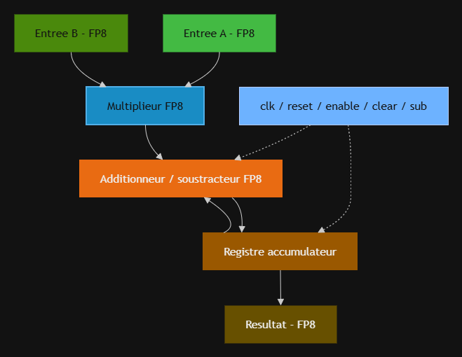
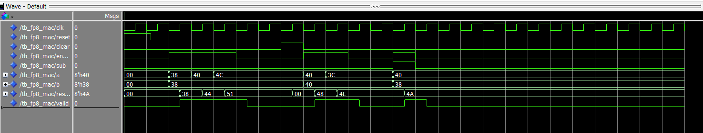
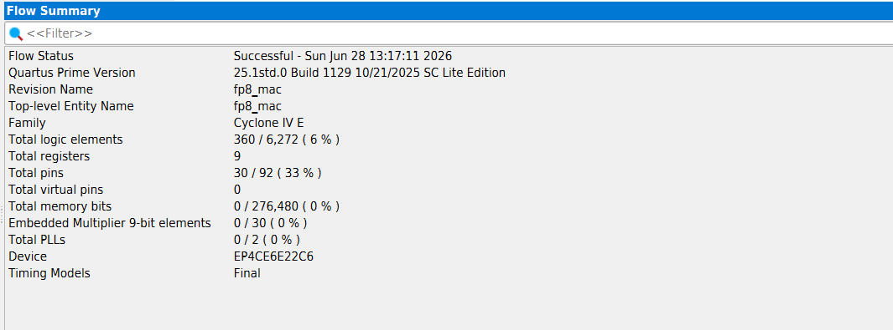

# Multiplieur-accumulateur (MAC) FP8 en VHDL pour l'inférence IA

Opérateur matériel **multiplieur-accumulateur** au format flottant **FP8 E4M3** (1 bit de signe, 4 bits d'exposant, 3 bits de mantisse, biais 7), décrit en VHDL, synthétisé sous Intel Quartus Prime et validé en simulation sous Questa.

> Projet individuel — Master 1 CSEC (Conception des Systèmes Électroniques Communicants), Université de Lorraine, 2026.

## Pourquoi le FP8 ?

Les réseaux de neurones reposent sur des millions de multiplications-accumulations. Réduire la précision des nombres (FP32 → FP16 → FP8) divise la mémoire, la bande passante et la taille des opérateurs. Le FP8 (proposé en 2022 par NVIDIA, Arm et Intel) est aujourd'hui utilisé pour l'inférence. Ce projet construit, bloc par bloc, l'opérateur de base d'un neurone : `acc = acc ± (a × b)`.

## Architecture



| Module | Rôle | Type |
|---|---|---|
| `fp8_pkg` | Paramètres du format (largeurs, biais) | Package |
| `fp8_decoder` | Séparation signe / exposant / mantisse, détection du zéro | Combinatoire |
| `fp8_mult` | Multiplication : XOR des signes, bit caché, produit des significandes, normalisation | Combinatoire |
| `fp8_addsub` | Addition / soustraction : alignement des exposants, bits de garde, normalisation gauche/droite | Combinatoire |
| `fp8_acc` | Registre accumulateur 8 bits (reset asynchrone, clear synchrone, enable) | Séquentiel |
| `fp8_mac` | Top-level : assemblage des blocs + signal `valid` | Séquentiel |

**Cas particuliers gérés :** zéro en entrée, saturation à ±448 en cas de dépassement, mise à zéro en cas de soupassement.

## Résultats

**Simulation du MAC complet** : accumulation `1 → 3 → 9`, effacement (`clear`), accumulation `4 → 7`, puis soustraction `7 − 2 = 5`.



| Valeur hexadécimale | `38` | `44` | `51` | `48` | `4E` | `4A` |
|---|---|---|---|---|---|---|
| Valeur décimale | 1,0 | 3,0 | 9,0 | 4,0 | 7,0 | 5,0 |

**Synthèse (Quartus Prime, Cyclone IV E EP4CE6E22C6)** :

| Module | Éléments logiques | Registres |
|---|---|---|
| Décodeur | 2 | 0 |
| Multiplieur | 66 | 0 |
| Additionneur / soustracteur | 291 | 0 |
| Accumulateur | 9 | 8 |
| **MAC complet** | **360 / 6 272 (≈ 6 %)** | **9** |



Un opérateur MAC complet tient dans environ 6 % d'un petit FPGA d'entrée de gamme : c'est l'intérêt du FP8 pour les accélérateurs d'IA. L'additionneur, à cause de l'alignement et de la normalisation, représente l'essentiel du coût.

## Structure du dépôt

```
src/    code VHDL (package + 5 modules)
tb/     bancs de test (décodeur, multiplieur, additionneur/soustracteur, MAC)
docs/   rapport complet (PDF), schémas, vue RTL, chronogramme, Flow Summary
```

## Lancer la simulation

**Avec Questa / ModelSim** : compiler `src/fp8_pkg.vhd` en premier, puis les autres fichiers de `src/`, puis le banc de test voulu dans `tb/`, et simuler `tb_fp8_mac`.

**Avec GHDL (gratuit)** :
```bash
ghdl -a --std=08 src/fp8_pkg.vhd src/fp8_decoder.vhd src/fp8_acc.vhd src/fp8_mult.vhd src/fp8_addsub.vhd src/fp8_mac.vhd tb/tb_fp8_mac.vhd
ghdl -e --std=08 tb_fp8_mac
ghdl -r --std=08 tb_fp8_mac --stop-time=200ns --wave=mac.ghw
```

## Limites et améliorations possibles

- **Arrondi par troncature** (pas d'arrondi au plus proche) → légère perte de précision.
- **Accumulation en FP8** : les petites contributions sont « avalées » par les grandes ; les accélérateurs réels accumulent en précision étendue (FP16/FP32).
- **Sous-normaux et NaN** non gérés.
- Pistes : arrondi au plus proche, accumulateur 16 bits, pipeline pour augmenter la fréquence, implantation sur carte réelle.

## Auteur

**Mohamed Amine BELKACEM** — Master 2 CSEC, Université de Lorraine
[LinkedIn](https://www.linkedin.com/in/mohamed-amine-belkacem-262582391/) · [GitHub](https://github.com/Amine552135)
